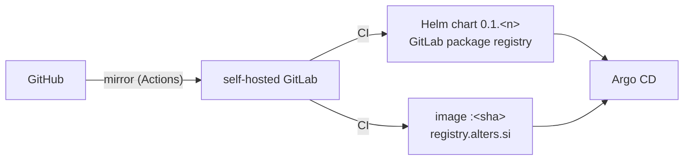

# alters.si

[](https://github.com/almajter/alters.si/actions/workflows/build.yml)

Source of my personal website, [alters.si](https://alters.si). Static
[Astro](https://astro.build) site, served by nginx on my Kubernetes cluster
([almajter/homelab](https://github.com/almajter/homelab)).

```sh
npm ci
npm run dev   # http://localhost:4321
```

## Delivery



- `Dockerfile`: Astro build, then `nginx-unprivileged` (non-root, port 8080).
- `chart/`: Deployment, Service, Ingress, PodDisruptionBudget. 2 replicas
  on different nodes, read-only root filesystem, no capabilities.
- `.gitlab-ci.yml`: builds the image (tag = short commit SHA) and publishes
  the chart (version `0.1.<pipeline>`, appVersion = the same SHA).
- Deploy: bump the chart version in the homelab repo.

Images are built with `--provenance=false`; GitLab's registry rejects
BuildKit's attestation index (`blob unknown to registry`).
